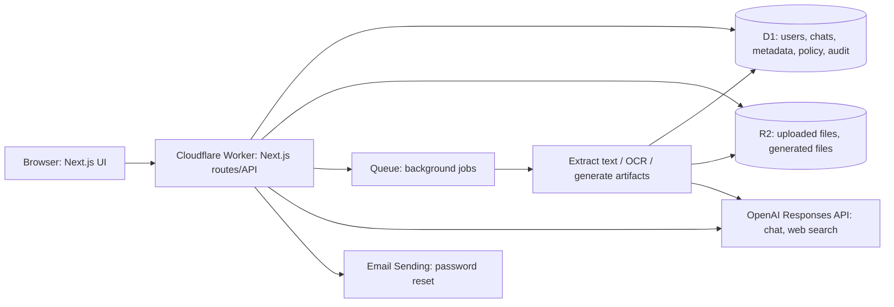

# BenterAI — เอกสารโครงสร้างระบบสำหรับออกแบบ Design System

**ฉบับอ้างอิง:** 26 ตุลาคม 2026  
**เว็บไซต์ปัจจุบัน:** https://demo.benterai.com/  
**วัตถุประสงค์:** ส่งให้ Claude Design ออกแบบหน้าตาและ Design System ก่อน แล้วจึงนำแบบที่อนุมัติกลับมาให้ Codex ปรับโค้ด

> เอกสารนี้อธิบายสิ่งที่มีอยู่ในโค้ดและพฤติกรรมที่ต้องคงไว้ ไม่ใช่ภาพหน้าจอที่ต้องลอกตาม แบบใหม่สามารถเปลี่ยน layout, สี, spacing, icon, typography และ micro-interaction ได้ โดยรักษา flow, สิทธิ์ และข้อมูลที่แต่ละหน้าต้องแสดง

## 1. ภาพรวมผลิตภัณฑ์

BenterAI เป็นพื้นที่ทำงาน AI สำหรับองค์กร ผู้ใช้สนทนากับโมเดล OpenAI, แนบไฟล์ในแชต, เลือกเอกสารจาก Knowledge, ค้นเว็บ, สร้างไฟล์หรือภาพ และจัดการประวัติแชต ผู้ดูแลจัดการผู้ใช้ กลุ่ม สิทธิ์ โมเดล โควตา audit log และนโยบายข้อมูล

- **แบรนด์:** BenterAI — “Build your own Enterprise AI” ใช้โลโก้สีน้ำเงินที่มีอยู่; หน้า login มีลิงก์กลับ `benterai.com`
- **ผู้ใช้หลัก:** สมาชิกองค์กรที่ใช้แชตและเอกสาร; ผู้ดูแลที่จัดการบัญชีและนโยบาย
- **ภาษา:** เนื้อหาภาษาไทยเป็นค่าเริ่มต้น; เมนูซ้ายภาษาอังกฤษเป็นค่าเริ่มต้น; เปลี่ยนสองส่วนนี้แยกกันใน Settings
- **อุปกรณ์:** desktop และ mobile; mobile ปัจจุบันย้ายเมนูซ้ายไปเป็นแถบแนวนอนด้านบน
- **ขอบเขต demo ปัจจุบัน:** องค์กรเดียวใน deployment นี้ แม้แนวทางผลิตภัณฑ์ระยะยาวคือแยก stack ต่อองค์กรลูกค้า

## 2. โครงสร้างที่ใช้งานจริง

**Frontend และ backend อยู่ใน Worker เดียวกัน**: `apps/web` ใช้ Next.js App Router + React + TypeScript, build ลง Workers ด้วย vinext. API อยู่ใต้ `apps/web/src/app/api`. งานนาน เช่น ประมวลผลเอกสารและสร้างไฟล์ ส่งเข้า Queue แล้วอัปเดตสถานะใน D1. `apps/api` และระบบ Python/Compose ใน repo เป็นสถาปัตยกรรมเก่าสำหรับอ้างอิง **ไม่ใช่ backend ของ demo ที่กำลังใช้งาน**.

Design System ไม่ควรแสดงชื่อผู้ให้บริการโครงสร้างพื้นฐานในข้อความ UI สำหรับผู้ใช้ทั่วไป เว้นแต่เป็นหน้าดูแลเชิงเทคนิคที่มีเหตุผลชัดเจน

## 3. แผนผังหน้าและ URL

| URL | หน้าปัจจุบัน | ผู้ใช้/เงื่อนไข | สิ่งที่ต้องมีในแบบใหม่ |
|---|---|---|---|
| `/` | Login | บุคคลทั่วไป | โลโก้, คำอธิบาย BenterAI สั้น ๆ, email, password, ลิงก์รีเซ็ต, ลิงก์ `benterai.com`, error/loading |
| `/reset` | ขอรีเซ็ตรหัสผ่าน | บุคคลทั่วไป | email, ผลลัพธ์แบบไม่เปิดเผยว่ามีบัญชีหรือไม่ |
| `/reset?token=…` | ตั้งรหัสผ่านใหม่ | ผู้มีลิงก์ในอีเมล | password ใหม่อย่างน้อย 10 ตัวอักษร, success/error |
| `/app` หรือ `/app/chat` | แชตใหม่ | `chat.use` | หน้าต้อนรับ + composer ขนาดใหญ่พร้อมใช้งานทันที |
| `/app/chat/:id` | แชตเดิม | เจ้าของแชต | transcript, แหล่งอ้างอิง, composer, recent chats |
| `/app/knowledge` | Knowledge | `documents.use` | อัปโหลด, สถานะ, download, version, share, delete |
| `/app/files` | Create files | `chat.use` | prompt, เลือก PDF/DOCX/HTML/PNG, โมเดล, รายการงานที่สร้าง |
| `/app/organization` | ผู้ใช้และสิทธิ์ | `users.list` และสิทธิ์ย่อย | users, groups, model grants/policy, audit, data policy |
| `/app/organization/usage` | AI Usage & Limits | `usage.manage` | สถิติใช้งาน, โควตาองค์กร/รายคน |
| `/app/settings` | Settings | ผู้ใช้ที่ล็อกอิน | personalization, password, ภาษา, font size, theme, นามสกุลไฟล์แชต |

การสลับหน้าต้องเปลี่ยน URL และใช้ Back/Forward ของ browser ได้ เมนูที่ไม่มีสิทธิ์ควรสื่อสถานะอย่างชัดเจน ไม่เปิดการทำงานที่ API ปฏิเสธ

## 4. App shell และหน้าบ้าน

### 4.1 App shell

บน desktop มีโลโก้ด้านบนของ sidebar, เมนู **AI conversations / Knowledge / Create files / Organization / Settings**, ปุ่ม **New chat**, ช่องค้นหา **Recent chats**, รายการแชต และข้อมูลผู้ใช้พร้อม Sign out. ด้านขวาเป็น header ชื่อหน้ากับปุ่มเข้า Settings และพื้นที่เนื้อหาหลัก. เมนู Organization ขึ้นกับสิทธิ์; Settings ใช้ได้ทุกคนที่ล็อกอิน

Recent chats รองรับเปิดแชต, ค้นหา, เปลี่ยนชื่อ, ปักหมุด, ส่งออกข้อความ และลบ. การทำรายการที่เป็น destructive ต้องมี confirmation ที่เข้าใจได้. Mobile ต้องยังเข้าถึงรายการแชตและเมนูครบ โดยไม่กินพื้นที่ composer มากเกินไป

### 4.2 แชต

**สถานะเริ่มต้น:** หลังล็อกอินเข้าหน้าแชต ไม่ผ่าน Overview; แสดงข้อความต้อนรับกลางพื้นที่และ composer ขนาดใหญ่. มี model selector ตามสิทธิ์ของผู้ใช้. เมื่อเริ่มคุย เปลี่ยนเป็น transcript ที่อ่านง่าย; user/assistant แยกชัด; ตอบแบบ streaming และมีปุ่ม Stop. ข้อความพร้อมแหล่งอ้างอิงจากเอกสารหรือเว็บต้องกดแหล่งข้อมูลได้

**Composer และปุ่ม `+`:**

1. **เพิ่มรูปและไฟล์**: อัปโหลดจากเครื่องหรือ paste; ไฟล์แชตไม่เกิน **5 MB**, ต้องผ่านชนิดไฟล์ที่ผู้ใช้เปิดไว้ใน Settings; แสดงกำลังอ่าน/พร้อมใช้/ล้มเหลว และลบไฟล์แนบได้
2. **เพิ่มจากไลบรารี**: เลือกเอกสาร Knowledge ที่ประมวลผลเสร็จแล้ว; ค้นหาชื่อเอกสารได้; เมื่อยังไม่มีเอกสารให้พาไปหน้าอัปโหลด; แสดงเอกสารที่เลือกและปุ่มเอาออก
3. **สร้างรูปภาพ**: นำ prompt ที่พิมพ์อยู่ไปหน้า Create files โดยเลือกชนิด PNG ไว้
4. **ค้นหาเว็บ**: toggle เปิด/ปิดให้เห็นสถานะชัด; เมื่อเปิด การส่งข้อความสั่งใช้ web search และแสดงลิงก์แหล่งข้อมูลที่กดได้

ใต้ composer มีตัวเลือก Knowledge: ไม่ใช้เอกสาร / ค้นทุกเอกสารที่พร้อมใช้ / เลือกเอกสารหนึ่งฉบับ. แชตเก็บประวัติและแหล่งอ้างอิง. ปัจจุบันไฟล์แนบหนึ่งรายการต่อ composer; การออกแบบหลายไฟล์พร้อมกันต้องระบุเป็น **ข้อเสนอเพิ่มความสามารถ** ไม่ใช่แค่เปลี่ยน UI

### 4.3 Knowledge

เอกสารระยะยาวใน workspace รองรับ **TXT, Markdown, CSV, JSON, PDF** สูงสุด **50 MB**. PDF สแกนใช้ OCR เบื้องหลัง. ไฟล์มีสถานะ `pending → processing → ready` หรือ `failed`, พร้อมความคืบหน้า OCR และสาเหตุที่อ่านไม่สำเร็จ. แสดงชื่อ ขนาด วันที่ เวอร์ชัน และสถานะ

ผู้มีสิทธิ์แก้ไขอัปโหลดเวอร์ชันใหม่หรือ delete ได้. เจ้าของแชร์เอกสารให้กลุ่มแบบ **ดู** หรือ **แก้ไข**. เวอร์ชันเก่ายังอยู่และดาวน์โหลดได้ แต่แชตค้นเฉพาะเวอร์ชันปัจจุบัน. เมื่ออ้างอิง PDF ในคำตอบ ต้องแสดง **ชื่อเอกสาร + เลขหน้า**; เอกสารอื่นแสดงส่วนที่ใช้ตอบ. อย่าสับสน Knowledge กับไฟล์แนบชั่วคราวในแชต

### 4.4 Create files

สร้างจาก prompt เป็น **PDF, Word `.docx`, HTML, PNG**. ผู้ใช้เลือกโมเดลที่มีสิทธิ์; รายการงานแสดงสถานะ `pending / processing / ready / failed`, ชื่อไฟล์, ดาวน์โหลด และลบ. ภาพสร้างด้วยเครื่องมือภาพ; PDF/DOCX/HTML สร้างจากข้อความของโมเดลแล้ว render เป็นไฟล์. ต้องมี state ระหว่างรอที่ไม่ทำให้ผู้ใช้คิดว่ากดแล้วไม่มีผล

### 4.5 Organization

หน้า `/app/organization` แบ่งเป็นแท็บ **ผู้ใช้และสิทธิ์** กับ **AI Usage & Limits** (แท็บหลังแสดงเฉพาะผู้มีสิทธิ์). ส่วน Access ปัจจุบันมี:

- ค้นหา/กรองผู้ใช้ตามสถานะ, สร้างผู้ใช้ด้วยอีเมล, แสดงรหัสผ่านชั่วคราวครั้งเดียว, อนุมัติบัญชี pending, ระงับ/เปิดใช้บัญชี
- สร้าง/แก้ไขกลุ่ม และสมาชิก/สิทธิ์ของกลุ่ม
- เปิด/ปิดโมเดล, grant โมเดลตามกลุ่ม, กำหนด default และ fallback model
- ค้น/กรอง/ส่งออก audit log
- ตั้ง retention, สั่ง cleanup และดาวน์โหลดข้อมูลองค์กร

**AI Usage & Limits** แสดงการใช้ OpenAI และตั้งจำนวนคำขอรายเดือนระดับองค์กร/ผู้ใช้. แบบใหม่สามารถแยกส่วนย่อยเป็นหน้าหรือ tabs เพิ่มได้ แต่ URL ที่มีอยู่และ permission gate ต้องได้รับการรองรับเมื่อ Codex ลงมือทำ

### 4.6 Settings

- **Personalization:** รูปแบบคำตอบ balanced / concise / detailed และ custom instructions เก็บในบัญชีผู้ใช้
- **Password:** เปลี่ยนรหัสผ่าน; บัญชีที่ถูกบังคับเปลี่ยนรหัสต้องเห็นสถานะชัด
- **Language:** ภาษาเมนูซ้าย (English/ไทย) และภาษาเนื้อหา (ไทย/English) เปลี่ยนแยกกัน
- **Font size:** ปรับ `0–4 pt` เพิ่มจากฐาน; ค่าเริ่มต้น `+1 pt`
- **Theme:** light/dark
- **Allowed chat upload extensions:** PDF, JPG/JPEG, PNG, WEBP, DOC, DOCX, XLSX, PPTX, TXT, MD, CSV, JSON, HTML

Theme, ภาษา และขนาดตัวอักษรเก็บใน browser localStorage; personalization และนามสกุลไฟล์ที่อนุญาตเก็บฝั่ง server. แบบใหม่ควรมีสถานะ focus, hover, disabled, loading, success/error ในทั้งสอง theme

## 5. หลังบ้านและข้อมูล

### 5.1 งานหลักของ backend

| ส่วน | หน้าที่ | แหล่งเก็บ/การประมวลผล |
|---|---|---|
| Auth | email/password, session cookie, reset link 15 นาที, sign out | credentials และ hash ของ session/reset token ใน D1; ส่งอีเมลผ่าน Email Sending |
| Authorization | ตรวจสิทธิ์ผู้ใช้/กลุ่มและสิทธิ์ต่อเอกสาร/โมเดล | D1; ตรวจใน API ไม่อาศัยการซ่อนปุ่มอย่างเดียว |
| Chat | ตรวจโควตา, อ่านประวัติ, รวม Knowledge/attachment, ส่งคำตอบแบบ SSE | D1 + OpenAI Responses API |
| Knowledge | อัปโหลด, เวอร์ชัน, grants, ดึงข้อความและอ้างอิง | ไฟล์ใน R2, metadata/chunks ใน D1, extraction/OCR ใน Queue |
| Attachments | ไฟล์เฉพาะแชต, อ่านเนื้อหาเบื้องหลัง | R2 + D1 + Queue |
| Artifacts | สร้าง PDF/DOCX/HTML/PNG, ติดตามสถานะ | Queue + OpenAI + R2 + D1 |
| Admin | users/groups, model policy, usage limits, audit, data policy | D1; export เป็น ZIP |
| Retention | ลบข้อมูลหมดอายุตามนโยบายองค์กร | scheduled job ประจำวัน; audit การลบ |

**กลุ่มตารางสำคัญ:** `users`, `user_credentials`, `auth_sessions`, `groups`, `user_groups`, `group_permissions`, `resource_grants`; `conversations`, `conversation_messages`, `chat_attachments`; `documents`, `document_chunks`, `document_group_grants`; `artifacts`; `model_registry`, `organization_model_policy`, `ai_usage_*`; `user_preferences`, `user_upload_settings`, `organization_data_policy`, `audit_log`.

### 5.2 API ที่ UI พึ่งพา

| งาน | API หลัก | ผลที่ UI ต้องรองรับ |
|---|---|---|
| Login/Logout | `POST /api/auth/login`, `/api/auth/logout` | session, error, rate limit, redirect |
| Password | `/api/auth/change-password`, `/api/auth/reset/request`, `/api/auth/reset/confirm` | password ขั้นต่ำ 10 ตัว, success/error |
| ตัวตน/ตั้งค่าส่วนตัว | `GET /api/me`, `/api/me/preferences`, `/api/chat/upload-settings` | permissions, preferences, allowed extensions |
| โมเดล | `GET /api/models` | เฉพาะโมเดลที่มีสิทธิ์, default model |
| แชต | `POST /api/chat`, `/api/conversations`, `/api/conversations/:id` | SSE delta/done/error, history, title/pin/delete |
| ไฟล์แนบแชต | `/api/chat/attachments`, `/api/chat/attachments/:id` | upload แล้ว poll จน ready/failed |
| Knowledge | `/api/documents`, `/api/documents/:id`, `.../download`, `.../shares`, `/api/documents/groups` | upload แล้ว poll, ACL, download, version |
| Artifacts | `/api/artifacts`, `/api/artifacts/:id`, `.../download` | create แล้ว poll, download/delete |
| Admin | `/api/admin/users`, `/groups`, `/models`, `/model-policy`, `/usage`, `/audit`, `/data-policy`, `/data-cleanup`, `/data-export` | permission, validation, confirmation, export |

API ส่วนใหญ่ตอบ JSON. งานประมวลผลใช้สถานะหลายขั้นแทนผลทันที. แชตใช้ **Server-Sent Events** เพื่อส่งตัวอักษรระหว่างตอบ, ตามด้วย `done` หรือ `error`. อย่าออกแบบ loading state แบบเดียวให้ทุกงาน: upload, OCR, chat และ generation มีระยะเวลาต่างกัน

### 5.3 Flow สำคัญ

1. **Login:** ผู้ใช้กรอก email/password → API ตรวจและออก cookie → ไป `/app/chat` หรือ `/app/settings` ถ้าต้องเปลี่ยนรหัส → UI อ่าน `/api/me` เพื่อกำหนดเมนูตามสิทธิ์
2. **Chat:** เลือกโมเดล/Knowledge/ไฟล์แนบ/ค้นเว็บ → ส่ง prompt → ตรวจสิทธิ์และโควตา → อ่านเอกสารที่เข้าถึงได้ → OpenAI ตอบแบบ streaming → บันทึกประวัติ, usage, audit และแหล่งอ้างอิง
3. **Knowledge:** upload → เก็บไฟล์ R2 และรายการ D1 → Queue ดึงข้อความ/OCR → status ready/failed → เลือกใช้ในแชต; การอัปโหลดฉบับใหม่สร้างเวอร์ชัน ไม่ทับฉบับเก่า
4. **Create files:** prompt + format + model → Queue สร้างและ render → เก็บ R2 → status ready → download
5. **Retention:** ผู้ดูแลกำหนดนโยบาย → scheduled/manual cleanup → ลบไฟล์และ metadata ที่หมดอายุ → บันทึก audit

## 6. สิทธิ์และข้อจำกัดที่ Design ต้องเคารพ

- ผู้ใช้ `active` เท่านั้นจึงใช้สิทธิ์จากกลุ่มได้; `pending`/`suspended` ต้องเห็นทางออกที่เข้าใจได้
- `chat.use`, `documents.use`, `users.list`, `users.create`, `users.manage`, `groups.manage`, `models.manage`, `usage.manage`, `audit.read` เป็น permission แยกกัน
- เอกสารที่แชร์ให้กลุ่มมี **view/edit** แยกกัน; เจ้าของจัดการ grants; editor อัปโหลดเวอร์ชันใหม่ได้
- แชตและไฟล์แนบเป็นของผู้ใช้เจ้าของ; URL แชตต้องตรวจสิทธิ์ทุกครั้ง
- การค้นเว็บเป็น opt-in และควรแสดงแหล่งข้อมูลที่กดได้; การใช้ Knowledge ต้องไม่อ้างเอกสารที่ผู้ใช้ไม่มีสิทธิ์
- ข้อมูลข้อความ/ไฟล์ที่ส่งให้โมเดลภายนอกต้องมี copy ที่อธิบายได้ แต่ไม่ใส่ศัพท์โครงสร้างพื้นฐานที่ผู้ใช้ไม่จำเป็นต้องรู้
- ปุ่ม destructive เช่น ลบแชต ลบเอกสาร ลบ artifact และ cleanup ควรมี confirmation ที่สอดคล้องกัน

## 7. สไตล์ปัจจุบัน — เป็นข้อมูลตั้งต้น ไม่ใช่ข้อบังคับให้คัดลอก

CSS ปัจจุบันใช้ **system font** (`system-ui`, `-apple-system`, `Segoe UI`) กับตัวแปร `--font-adjust`. โทนหลักเป็นสีน้ำเงิน: `#0755f5`, ตัวอักษร `#152a50`, พื้น `#f8faff`, surface สีขาว; มี dark theme แบบ CSS variables. ตัวอย่าง breakpoint ปัจจุบัน: **760px** เปลี่ยน shell เป็น mobile และ **1100px** ปรับ sidebar/content. โลโก้สีน้ำเงินอยู่ในเว็บแล้ว

Claude Design สามารถเปลี่ยน token ทุกตัว แต่ควรส่งกลับมาเป็นชุด token ที่ระบุค่า light/dark, typography ภาษาไทย/อังกฤษ, spacing, radius, border, shadow, icon, motion และ breakpoint ที่ชัดเจน. กรุณาออกแบบให้ตัวอักษรภาษาไทยอ่านง่ายที่ขนาดปกติและเมื่อผู้ใช้เพิ่ม font size 0–4 pt

## 8. สิ่งที่ขอให้ Claude Design ส่งกลับมา

1. **Design principles** ของ BenterAI 3–5 ข้อ พร้อมเหตุผลที่เกี่ยวกับผู้ใช้จริง
2. **Design tokens**: สี semantic ทั้ง light/dark, typography scale, spacing, radii, elevation, grid, breakpoints และ motion
3. **Component library**: sidebar/top nav, recent chat item, buttons, inputs, select, tabs, menu `+`, composer, message bubble, source citation, document row/card, status badge, upload progress, table, dialog, toast, empty/error/loading states
4. **Screen designs** desktop + mobile: login, reset, new chat, existing chat, Knowledge, Create files, Organization Access, AI Usage & Limits, Settings
5. **State variants**: ไม่มีข้อมูล, กำลังโหลด, สำเร็จ, ผิดพลาด, ไม่มีสิทธิ์, ส่งคำตอบอยู่, อัปโหลด/OCR อยู่, ไฟล์ล้มเหลว, dark theme, ภาษาไทย/อังกฤษ และ font size ที่เพิ่มขึ้น
6. **Clickable prototype หรือ flow map** อย่างน้อย login → chat → เพิ่มเอกสาร → เลือก Knowledge → ตอบพร้อม citation; และ admin → สร้างผู้ใช้ → กำหนดสิทธิ์
7. **Handoff specification** สำหรับ Codex: token names/values, component anatomy, responsive behavior, interaction states, asset/icon list และสิ่งที่ต่างจากระบบเดิม

ขอให้ระบุรายการที่เป็น **การปรับเฉพาะหน้าตา** กับรายการที่เป็น **feature ใหม่** แยกกัน เพื่อไม่ให้การ implement รอบถัดไปตีความผิด

## 9. ข้อความพร้อมส่งให้ Claude Design

> ออกแบบ Design System และหน้าจอ BenterAI จากเอกสารนี้ โดยยังไม่เขียนโค้ดจริง เป้าหมายคือ SaaS AI workspace สำหรับองค์กรไทย ดูทันสมัย เรียบ อ่านง่าย และมีบุคลิก BenterAI ใช้โลโก้สีน้ำเงินที่แนบให้ รักษา flow, URL, permission, สถานะงานเบื้องหลัง และชนิดข้อมูลตามเอกสาร แต่เสนอ layout และ visual language ใหม่ได้เต็มที่ แสดง desktop/mobile, light/dark, ไทย/อังกฤษ และ state สำคัญทุกหน้า ส่ง design tokens, component specs, screens และ interactive flows พร้อมแยกข้อเสนอ feature ใหม่ออกจาก visual redesign เพื่อให้ผมนำแบบที่เลือกกลับไปให้ Codex implement

## 10. จุดอ้างอิงใน repo สำหรับการ implement ภายหลัง

| ส่วน | ที่ตั้งปัจจุบัน |
|---|---|
| Login/Reset | `apps/web/src/app/page.tsx`, `apps/web/src/app/reset/page.tsx` |
| Shell และ Settings/Admin | `apps/web/src/app/dashboard.tsx` |
| Chat | `apps/web/src/app/chat-workspace.tsx` |
| Knowledge | `apps/web/src/app/document-workspace.tsx` |
| Create files | `apps/web/src/app/artifact-workspace.tsx` |
| สี/spacing/layout | `apps/web/src/app/globals.css` |
| ข้อความไทย/อังกฤษ | `apps/web/src/lib/i18n.ts` |
| API | `apps/web/src/app/api/**/route.ts` |
| Auth/สิทธิ์ | `apps/web/src/lib/request-auth.ts`, `authz.ts`, `document-access.ts` |
| Worker background jobs | `apps/web/src/worker.ts`, `apps/web/src/lib/*-processing.ts` |
| โครงสร้างข้อมูล | `infra/cloudflare/migrations/*.sql` |

**แนวทางส่งกลับให้ Codex:** แนบเอกสารนี้ + ไฟล์/ลิงก์แบบจาก Claude + ระบุหน้าที่อนุมัติแล้ว, token ชุดสุดท้าย, component variants และส่วนใดต้องเพิ่มความสามารถหลังบ้าน. Codex จึงจะเปลี่ยน UI ให้ตรงแบบได้โดยไม่เดาความตั้งใจ
